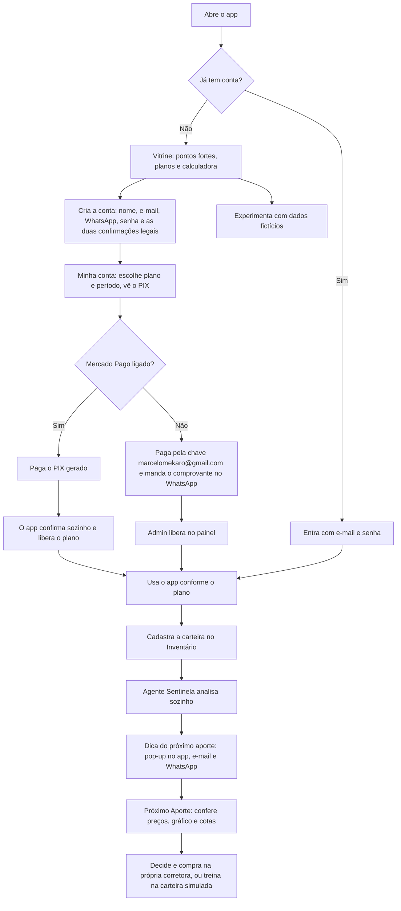
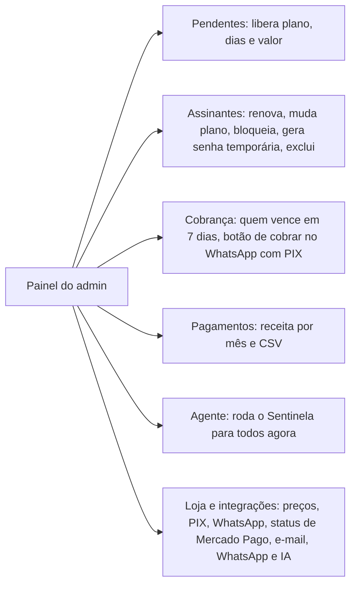
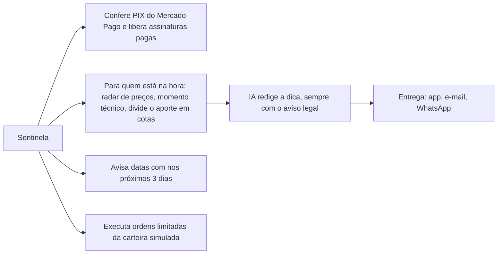

# Chrono Trade: telas e fluxos

As imagens estão em `docs/telas/` e foram tiradas com o **modo demonstração** (dados fictícios).

## Fluxo do cliente (do cadastro à dica do aporte)

## Fluxo do administrador

## O que o agente Sentinela faz a cada hora

## Telas

| Tela | Para que serve | Plano |
|---|---|---|
|  **Vitrine e entrada** | Pontos fortes, calculadora de desconto, planos, comparativo, cadastro com aceite legal, teste grátis | Todos |
|  **Vitrine no celular** | A mesma tela ajustada ao Android | Todos |
|  **Pagamento** | Escolha do plano e período, QR Code, chave PIX, copia e cola, comprovante pelo WhatsApp | Todos |
|  **Admin: pendentes** | Liberar cadastros com plano, dias e valor | Admin |
|  **Admin: loja** | Preços, PIX, WhatsApp, teste do PIX e situação das integrações | Admin |
|  **Portal** | Patrimônio, proventos e a linha do tempo até a meta de renda | Básico |
|  **Inventário** | Cadastro da carteira e raio-x com DY, yield on cost e preço teto | Básico |
|  **Tesouro** | Proventos mês a mês, número mágico e constância | Básico |
|  **Agenda de proventos** | Próximas datas com e quanto deve cair por mês | Básico |
|  **Linha do Tempo** | Projeção com cenários e os marcos da jornada | Básico |
|  **Oráculo: ficha rápida** | Bazin, Graham, P/L, P/VP e checklist | Básico |
|  **Próximo Aporte** | Radar de preços, análise técnica com gráfico e divisão do aporte em cotas | Médio |
|  **Avisos** | Dicas do Sentinela, datas com e confirmações; pedir uma dica agora | Básico (e-mail no Médio, WhatsApp no Premium) |
|  **Corretora** | Carteira simulada com ordens; MetaTrader 5 no Premium | Médio / Premium |
|  **Compartilhar** | Relatório para imprimir ou PDF, com opção de ocultar valores | Médio |

O **Oráculo: conselho de agentes de IA** (vários agentes debatem uma ação) é do plano Premium, com 30 análises por mês.

## Avisos legais no app
- Cadastro só com duas confirmações: termos de uso e "o Chrono Trade não faz recomendação; as decisões e os riscos são meus".
- Aviso legal no fim das telas com números de investimento, na vitrine e na barra lateral.
- Toda dica do Sentinela termina com o aviso, inclusive quando escrita pela IA (o app confere e acrescenta se faltar).
- Ordens pedem confirmação explícita; ordens reais ficam desligadas por padrão.
- Termos com Resoluções CVM 19 e 20, aviso de risco, direito de arrependimento e LGPD (modelo para revisar com advogado).
